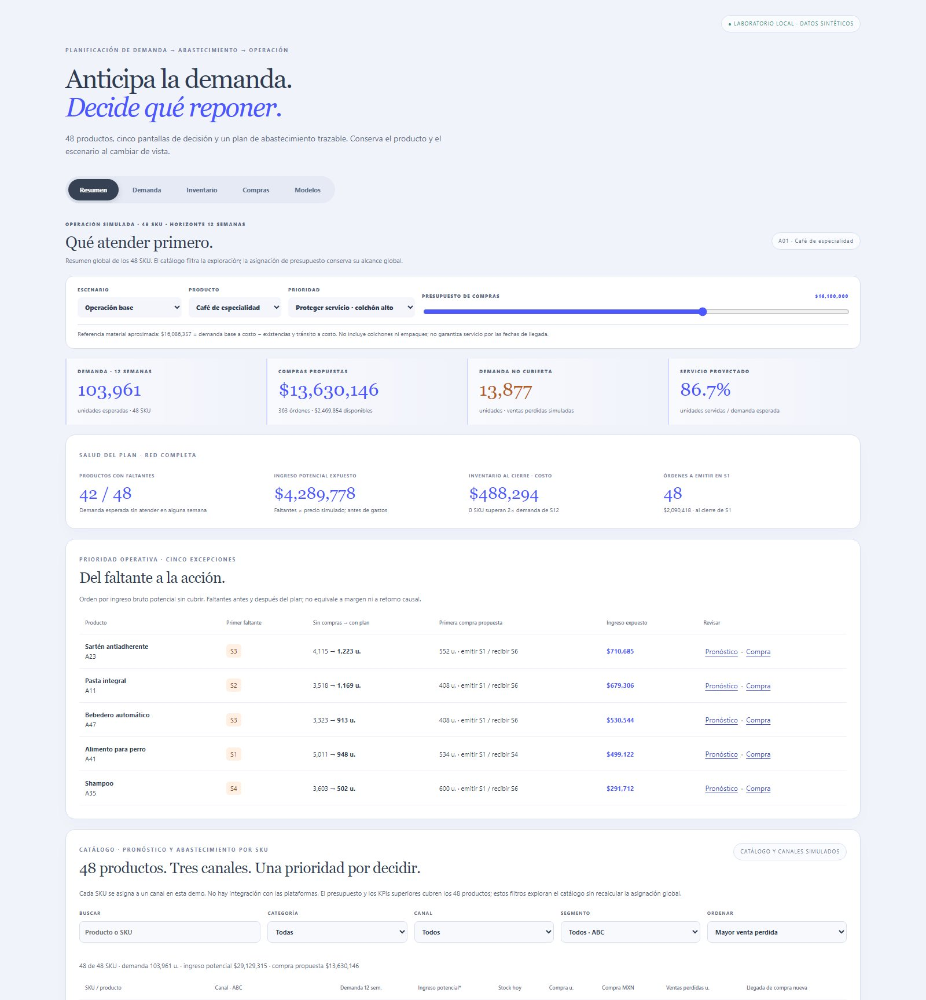

# DockMind · Demanda, compras y evaluación de modelos

Prototipo de **planificación de demanda y compras**: pronostica 12 semanas, arma
el calendario de compras, simula el balance semanal de inventario y evalúa cuatro
familias de modelos con un protocolo temporal explícito. La aprobación de la
compra es local y efímera.

[](https://github.com/Dev-HugoAguilar/dockmind-demand-planning/actions/workflows/tests.yml)
[](#demo)
[](#modelos-y-protocolo)

> **Alcance.** Catálogo **sintético**: 48 SKU y tres canales simulados. El
> benchmark público se usa solo como validación independiente del método, no para
> abastecer el catálogo. Las métricas describen este experimento, no una mejora
> generalizable.

---

## Demo

```bash
git clone https://github.com/Dev-HugoAguilar/dockmind-demand-planning.git
cd dockmind-demand-planning
python -m http.server 8000 --directory web
```

Abre <http://127.0.0.1:8000/>. No hay CDN, Atlas, LLM ni API de *marketplace*: D3,
datos y estilos son archivos locales del mismo origen.

Para revisar sin servidor, `legacy/DockMind_prototipo.html` es una versión
autocontenida con CSS, D3, resultados de entrenamiento y JavaScript incluidos.



## Qué demuestra

- **Cinco pantallas exclusivas** —resumen, demanda, inventario, compras y
  modelos— con navegación por teclado y estado compartido.
- **Un protocolo temporal defendible**: ventanas de entrenamiento que terminan
  antes de cada corte, selección del ganador por WAPE de validación y evaluación
  posterior en test.
- **Trazabilidad del balance**: cada semana cierra con
  `apertura + existencias + recepciones − servido = cierre`, y
  `servido + perdido = demanda`.
- **Compra que respeta el empaque**: cada pedido es múltiplo del *pack* y llega en
  la semana `colocación + lead time + 1`.
- **Faltantes que no se tapan con sobrecompra**: un pedido futuro no cubre demanda
  perdida antes de su llegada; hay una regresión dedicada a eso.
- **Bandas honestas**: cuantiles 10/90 de residuos de validación, con cobertura
  medida en test y objetivo del 80 % sin garantías individuales.

## Modelos y protocolo

Cuatro familias compiten en horizontes de 1, 4, 8 y 12 semanas:

| Familia | Nota |
|---|---|
| Estacional 52 | Referencia estacional simple. |
| Holt | Tendencia y nivel. |
| Ridge multisalida | Artefactos `joblib` en `models/`. |
| Random Forest multisalida | Artefactos `joblib` en `models/`. |

Decisiones del diseño:

- Normalización por media de las ocho semanas previas; rezagos y estadísticas
  calculados **solo** con historia disponible.
- *Targets* directos a 12 pasos; los modelos son **globales por conjunto**, no un
  bosque por SKU.
- Hiperparámetros fijos; el ganador se elige por WAPE de validación, **no** de
  test. Los cortes sintéticos son validación en 64/68/72 y test en 84/88/92.
- Los horizontes y cortes **se solapan**: no son muestras independientes ni
  intervalos de confianza de una mejora.
- Sin reentrenamiento en el navegador y sin LLM.

El benchmark independiente son 45 tiendas × 143 semanas de ventas históricas
reproducidas de un repositorio público. Es **importe reportado en USD**, no
unidades de SKU, y no alimenta el catálogo sintético.

## Estructura

```text
web/                      Aplicación servible (sin compilación)
  index.html              Cinco pantallas, controles y contenido editorial
  data.json               Catálogo sintético y resultados de entrenamiento
  vendor/d3.min.js        D3 v7.9.2 (ISC), servido localmente
models/                   Artefactos joblib de los dos modelos multisalida
research/model_report.json Resultados, cortes, métricas y procedencia
pipeline/                 prepare_data.py · train_models.py · build.py · download_benchmark.py
qa/                       verify_runtime.cjs · verify_ui.cjs
legacy/                   Prototipo autocontenido de un solo archivo
docs/                     Auditoría, referencias y diseño
```

## Reproducir

Python 3.12 y `pip install -r pipeline/requirements.txt`; ejecutar desde
`pipeline/`:

1. `python prepare_data.py` genera el catálogo en `web/data.json`. Sustituye los
   resultados, así que debe correr **antes** del entrenamiento.
2. `python download_benchmark.py` obtiene el CSV público (requiere red). El archivo
   crudo no se redistribuye.
3. `python train_models.py research/Walmart.csv` entrena ambos conjuntos y
   actualiza `web/data.json`, `research/model_report.json` y `models/`.
4. `python build.py` regenera el prototipo autocontenido.

Para trabajar solo con datos sintéticos, `python train_models.py` sin argumento
omite el benchmark público. **No hace falta reentrenar para servir la demo.**

## Verificación

La interfaz se verifica sin navegador real, con jsdom, sobre el runtime publicado:

```bash
npm ci
npm run verify
```

- `verify_runtime.cjs` recorre **36 escenarios** (retraso × promoción ×
  presupuesto × colchón) y comprueba calendario en semanas completas, stock,
  demanda, empaques, presupuesto, horizonte y selección temporal. Además incluye
  la regresión de faltantes previos a recepción.
- `verify_ui.cjs` comprueba carga, cinco pantallas exclusivas, teclado y *hash*
  inválido, presupuesto, filtros vacíos, tabla de pronóstico, aprobación e
  invalidación, benchmark en USD y que ningún atributo SVG sea `NaN` o `Infinity`.

La integración continua ejecuta ambas verificaciones en cada *push*.

## Límites

- Catálogo sintético: los resultados no describen una operación real.
- Los cortes se solapan; no son muestras independientes.
- Las bandas son residuos agrupados de validación, no intervalos por SKU.
- El benchmark público mide importe en USD y no se usa para abastecer el catálogo.
- La aprobación no persiste: no escribe archivos, bases ni sistemas externos.
- No se probaron navegadores distintos de los usados en la verificación.

## Datos y atribución

Benchmark público de ventas históricas citado en
[`docs/REFERENCIAS.md`](docs/REFERENCIAS.md). D3 v7.9.2 bajo licencia ISC. Este
repositorio no incluye un archivo `LICENSE` propio: se respetan las condiciones de
las fuentes citadas.

## Contribuir y seguridad

Convenciones en [`CONTRIBUTING.md`](CONTRIBUTING.md). Para reportar un problema de
seguridad, usa los avisos privados de [`SECURITY.md`](SECURITY.md).
